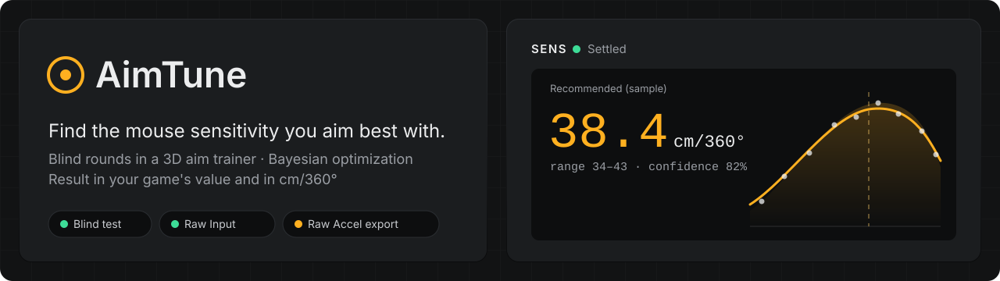
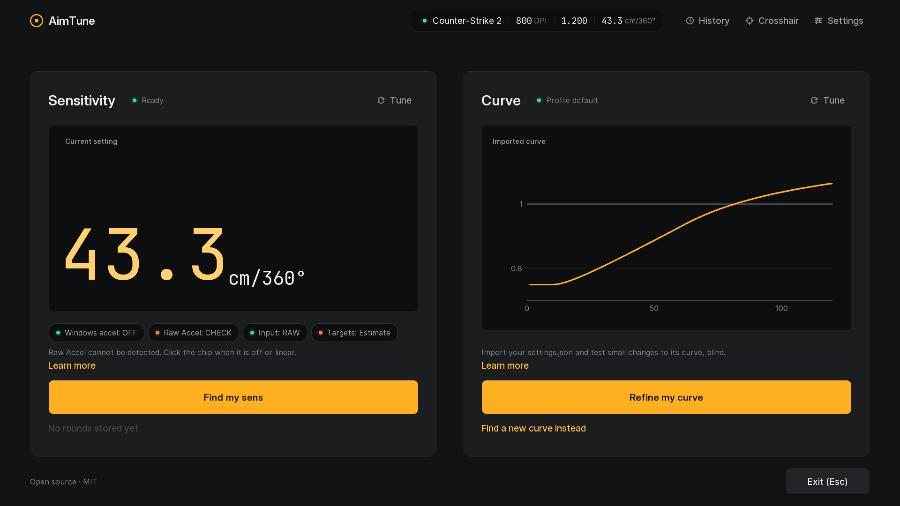
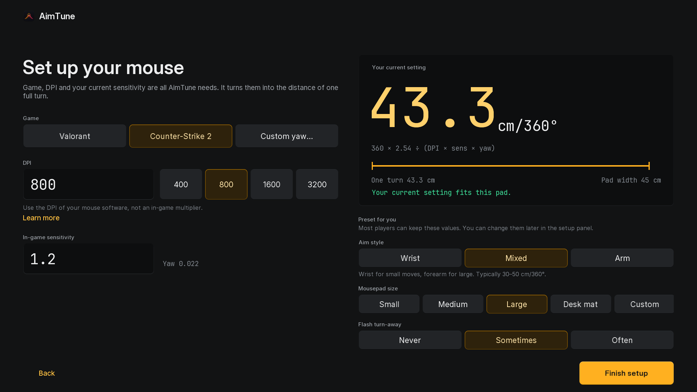
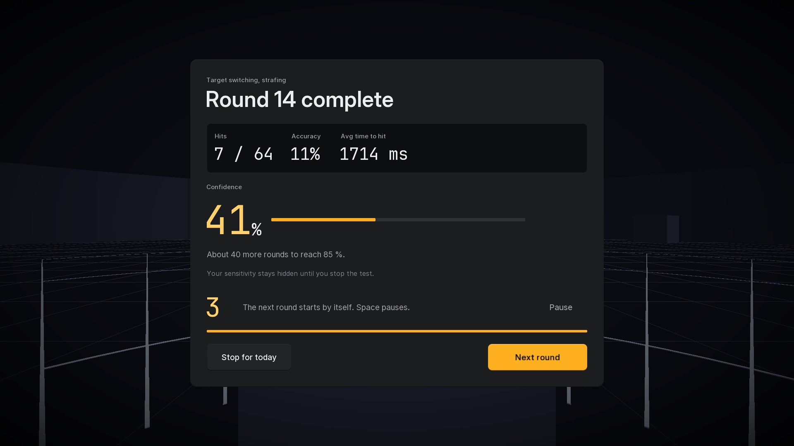
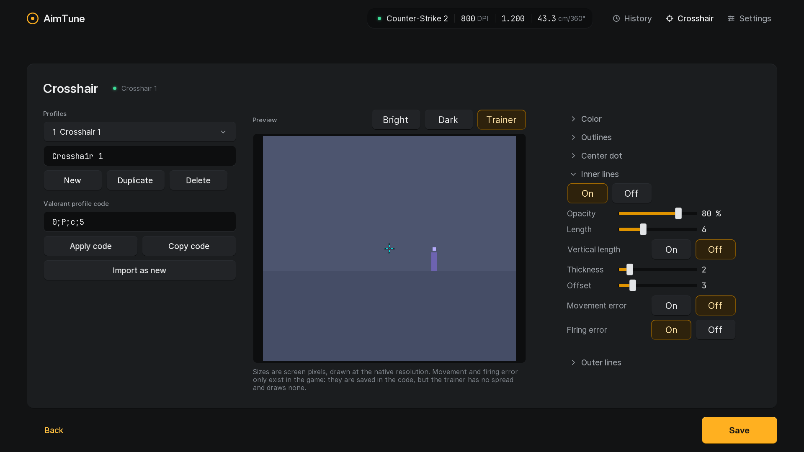
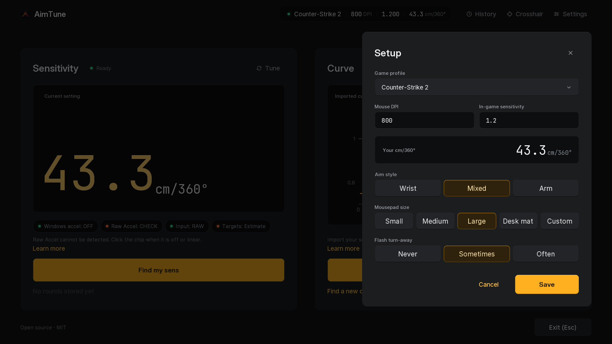
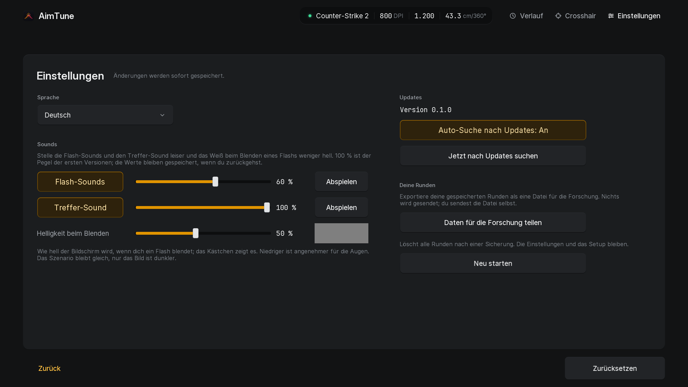
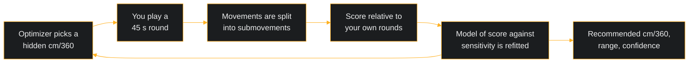

<div align="center">



<br>

[](https://github.com/veqzo/Aim-Tuner/actions/workflows/ci.yml)
[](https://github.com/veqzo/Aim-Tuner/tags)
[](LICENSE)


**Blind aim rounds pick your sensitivity, not your expectation.**<br>
AimTune plays short rounds in its own 3D trainer, fits a model of your score against sensitivity<br>
and gives you one number for your game, in its own value and in cm/360°.

[Install](#-install) · [How to use](#-how-to-use) · [How it works](#-how-it-works) · [Limitations](#%EF%B8%8F-limitations) · [Build](#%EF%B8%8F-build) · [Docs](#-documentation)

<br>



<sub>The dashboard: two rack modules. SENS finds your sensitivity, CURVE finds or refines a Raw Accel curve.</sub>

</div>

---

## ✨ What it does

<table>
<tr>
<td width="50%" valign="top">

### 🎯 Blind sensitivity search
Short aim rounds at sensitivities that a Bayesian optimizer chooses. You never see which one you play, so your expectation cannot decide the result.

</td>
<td width="50%" valign="top">

### 📈 A result you can use
The recommended sensitivity as your game's value and as cm/360°, the range in which your scores were equal, a confidence and a history of sessions.

</td>
</tr>
<tr>
<td valign="top">

### 🧪 Several round types
Flick, micro-adjust, tracking, target switching, and turning away from a flash and back. Games with a shooting range profile (Valorant) also get **Range mode** with strafing bots.

</td>
<td valign="top">

### ✚ Your own crosshair
Paste a Valorant profile code or build one in the editor. It is drawn pixel-exact at your resolution. The results say whether your misses are mostly vertical or horizontal ([format](docs/CROSSHAIR.md)).

</td>
</tr>
<tr>
<td valign="top">

### 〰️ Optional Raw Accel curve <sub>experimental</sub>
Find a speed-dependent curve in blind rounds, or import your [Raw Accel](https://github.com/RawAccelOfficial/rawaccel) `settings.json` and refine it. Every curve is tested blind against plain sensitivity. AimTune exports a `settings.json` only when the curve is clearly better. The back of the CURVE module explains every other Raw Accel setting.

</td>
<td valign="top">

### 🔬 Share data for research
Writes your stored rounds into one file without name, paths or clock times. You send it yourself; nothing is uploaded ([format](docs/RESEARCH-EXPORT.md)). English and German UI.

</td>
</tr>
</table>

## 📸 Screens

| One-screen setup | Between rounds |
| --- | --- |
|  |  |
| **Result** | **Curve layout** |
|  |  |

<details>
<summary><b>More screens</b></summary>

<br>

| A blind round (Range mode) | History |
| --- | --- |
|  |  |
| **Crosshair editor** | **Setup panel** |
|  |  |
| **Settings in German** | |
|  | |

All values are sample data. `./gradlew :app:screenshots` renders the screens (`:app:screenshotsDe` for German).

</details>

## 📦 Install

1. Download `AimTune-<version>-windows.zip` from the [latest release](https://github.com/veqzo/Aim-Tuner/releases) and unzip it anywhere (or run the `-setup.exe` installer if the release has one).
2. Start `AimTune\AimTune.exe`. It brings its own Java runtime; you do not have to install anything else.
3. The program is not code-signed yet. If Windows SmartScreen warns you, choose **More info**, then **Run anyway**.

> [!NOTE]
> Once a day the app checks GitHub for a newer release. When it finds one, the dashboard shows "Version X is available (U)". Nothing is downloaded or installed without your click. Turn the check off in Settings or start with `--no-update-check`.

Settings and rounds are stored in `%APPDATA%\AimTune` (set `AIMTUNE_DATA_DIR` to use another folder). Delete that folder to reset everything.

## 🚀 How to use

| Step | What you do |
| :-: | --- |
| **1 · Set up** | One screen: your game, mouse DPI and current in-game sensitivity. AimTune shows the cm/360° live. Aim style, mousepad and flash turn-away come preset; change them later through the **setup pill** at the top. Turn off *Enhance pointer precision* in Windows and any Raw Accel curve before you test. The check chips on the SENS module show both. |
| **2 · Find my sens** | Press **Find my sens** (Enter). Each round lasts 45 seconds: hit the targets as fast and accurately as you can. Between rounds a card shows your hits and the confidence; the sensitivity of the round is never shown. From the second round a **3 s countdown** starts the next round (Space pauses). Play 15 to 30 rounds, ideally on two days. *Stop for today* is always there. |
| **3 · Read the result** | The result shows the recommended sensitivity as your game's value and as cm/360°, the range and the confidence. Type the value into your game and play with it for a few days before you judge it. |
| **4 · Curve** <sub>optional</sub> | On the CURVE module, **Find a curve** (A) searches a curve blind, then tests it blind against plain sensitivity. With an imported `settings.json`, **Refine my curve** tries small changes to your own curve. Most players get "no curve is clearly better". That is a normal answer. |

<details>
<summary><b>Keyboard</b></summary>

<br>

| Key | Action |
| :-: | --- |
| `Enter` | Main action of the screen |
| `Esc` | Back (closes the setup panel first); in a round: abort |
| `Space` | Pause or resume the countdown between rounds |
| `A` | Open the curve |
| `F` / `G` | Flip the SENS / CURVE module to its options |
| `M` | Switch the SENS start between the blind test and Range |
| `R` · `H` · `C` · `S` · `U` | Results · History · Crosshair · Settings · Update |
| `F11` | Fullscreen (kept for the next start) |
| `F3` | Debug overlay (free trainer only) |

</details>

## 🧠 How it works



- **Blind rounds.** The program plays short rounds at different sensitivities and hides which one. Your expectation cannot decide the result.
- **A score per round.** Each round gets a score from how often your first shot hit and how fast you hit, compared with your own other rounds. The score is relative to you. It is not a rating.
- **A model of score against sensitivity.** A Gaussian process on cm/360° (log scale) fits a smooth curve to the scores. The next round goes where the model learns the most. Rounds from earlier days count, and each day can have its own level. A steady change within a day (warm-up, fatigue) is detected and lowers the confidence.
- **Confidence.** The chance that no other sensitivity in the tested range is noticeably better than the recommended one. It is not a promise about your game.
- **Targets.** The targets have the angular size of a head at typical distances, defined per game in `games/*.json`.

The full method with diagrams, a glossary and all formulas: **[docs/ALGORITHMS.md](docs/ALGORITHMS.md)**.

## ⚠️ Limitations

AimTune says what it has shown and what it has not. Read this before you trust a number.

<details>
<summary><b>Show all limitations</b></summary>

<br>

- **The target sizes are estimates.** Riot publishes no head size or movement speeds, so the Valorant profile uses a head of about 0.2 m seen from 6 to 30 m. The *Targets* chip on the dashboard says so until the values are measured in the game (see [docs/history/REVIEW.md](docs/history/REVIEW.md)). The recommended sensitivity depends on target size.
- **Checked against a simulated player, not against many people.** The method recovers the best sensitivity of a simulated player to within about 10-20 % at 15 rounds. How well real people behave like it is not measured yet (see [docs/history/ASSESSMENT.md](docs/history/ASSESSMENT.md)).
- **The result is a range, not an exact value.** Controlled studies and the simulations agree that scores are flat around the best sensitivity: a difference of 15 % is below what a 45-second round can measure. The app shows the stretch in which your scores were equal, and says so when they were equal almost everywhere. Fatigue and learning can move the result; play on more than one day.
- **A clean aim test is not a game.** Nothing shows yet that the best sensitivity in a trainer is the best one in a match (movement, peeking, pressure); no study of that was found.
- **Acceleration is experimental.** In simulations the blind search of the curve strength found preferences of 15 % and more, the optional error analysis only large ones (a falling gain of 25 % or more). All of it comes from simulated players; whether real players have such preferences is not known. "No curve" does not mean that no curve could help. No study of acceleration for first-person aiming was found. In simulations the refine search found no preference in the shape of an imported curve either, because the curve barely acts where the simulated hand moves. Right after a switch, any new curve scores worse than a familiar one. The exported file follows the Raw Accel 1.7.1 settings format but has not been loaded into Raw Accel by the author yet. The analysis needs a mouse report rate of 1000 Hz or more and Windows Raw Input.
- **Windows only.** The window should be 16:9; other shapes are letterboxed to it (the FOV of the game at other shapes is unknown).

</details>

## 🔒 Safety

AimTune is built to be safe next to competitive games:

- It **never touches game processes**: no injection, no game memory, no input manipulation outside its own window.
- It **reads mouse input only while its own window is focused**.
- It **never edits game configs**. Curves are only simulated in the app and exported as a file for [Raw Accel](https://github.com/RawAccelOfficial/rawaccel).

## 🛠️ Build

```bash
./gradlew build        # build and run the tests
./gradlew :app:run     # start the app
```

The first start opens the one-screen setup. Everything is stored in `%APPDATA%\AimTune\settings.json`; the setup panel changes it later. Developer options (`--seed`, `--source`, `--no-vsync`, `--screenshots <dir>`, `--language <code>`, `--record <dir>`) are listed in `LaunchOptions.USAGE`.

Finished rounds are analysed (first-movement error, corrections, path efficiency) and stored in a local SQLite database in `%APPDATA%\AimTune`.

<details>
<summary><b>Packaging and JDK setup</b></summary>

<br>

`./gradlew :app:jpackage` packages the app with its own Java runtime into `app/build/jpackage/AimTune/AimTune.exe`. Add `-PinstallerType=exe` or `msi` for an installer; that needs the WiX toolset. See [ADR 0005](docs/adr/0005-jpackage-without-plugin.md).

Gradle runs on the JDK in `JAVA_HOME` (Gradle 9.6.0 supports JDK 17 up to 25). The project compiles for Java 21 through a Gradle toolchain. The foojay resolver plugin downloads JDK 21 automatically if it is not installed.

</details>

**Project layout**

| Module | Purpose |
| --- | --- |
| `core` | Pure Kotlin logic: units, metrics, segmentation, Gaussian process, optimizer, acceleration fit, simulated player. No LibGDX, fully testable. |
| `games` | `GameProfile` and the JSON profiles in `games/`. |
| `input` | Mouse input: Windows Raw Input via JNA, GLFW fallback. |
| `storage` | SQLite and the settings JSON in `%APPDATA%\AimTune`. |
| `app` | LibGDX / Scene2D UI in the "Rack" design, scenario rendering, i18n, packaging. |

## 📚 Documentation

| Document | What is in it |
| --- | --- |
| [Specification](docs/SPEC.md) | What the app does |
| [Architecture](docs/ARCHITECTURE.md) | How it is built |
| [Algorithms](docs/ALGORITHMS.md) | The method in plain words with diagrams, then every formula and measurement |
| [Design](docs/DESIGN.md) | The "Rack" design system, screens and flow ([ADR 0006](docs/adr/0006-ui-rack.md)) |
| [Range mode](docs/RANGE.md) | The Valorant shooting range model and how it was measured |
| [Crosshair](docs/CROSSHAIR.md) | The crosshair format |
| [Research export](docs/RESEARCH-EXPORT.md) | The "Share data for research" file |
| [Tester guide](docs/TESTER-GUIDE.md) | Step by step for testers ([Deutsch](docs/TESTER-GUIDE.de.md)) |
| [Progress](docs/PROGRESS.md) | Current status and history of the work |
| [History](docs/history) | Older reviews, the independent assessment and the curve finder audit |
| [Contributing](CONTRIBUTING.md) | How to contribute and how to add a game |

## 📄 License

[MIT](LICENSE). Third-party components are listed in [THIRD-PARTY-NOTICES.md](THIRD-PARTY-NOTICES.md).

<div align="center">
<br>
<sub>Built with Kotlin and LibGDX · no game memory, no injection, no driver</sub>
</div>
